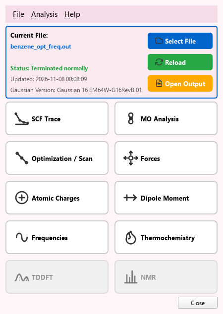
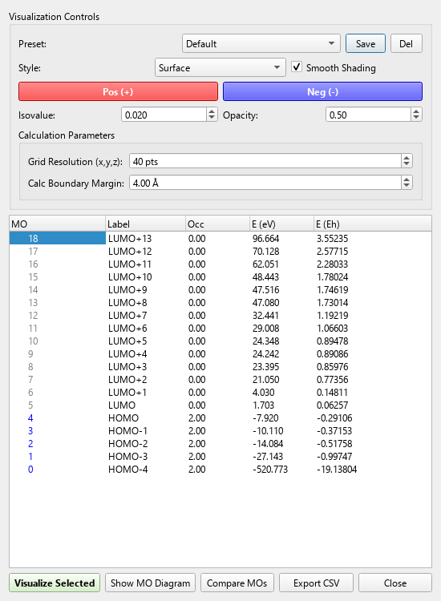
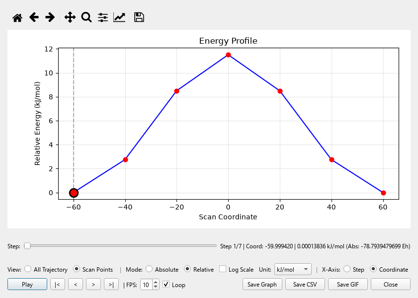
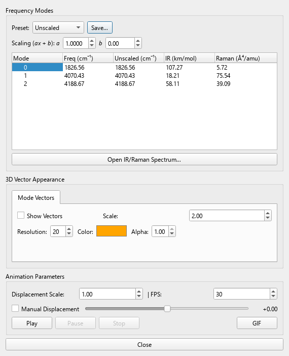
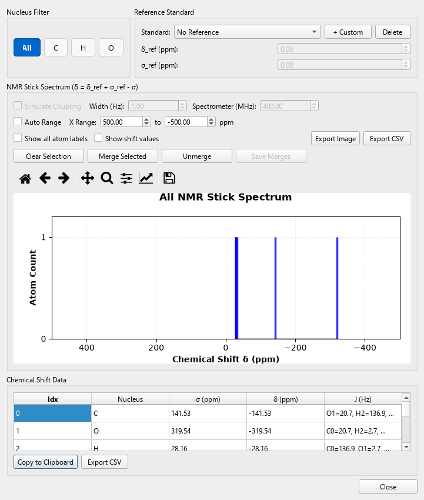
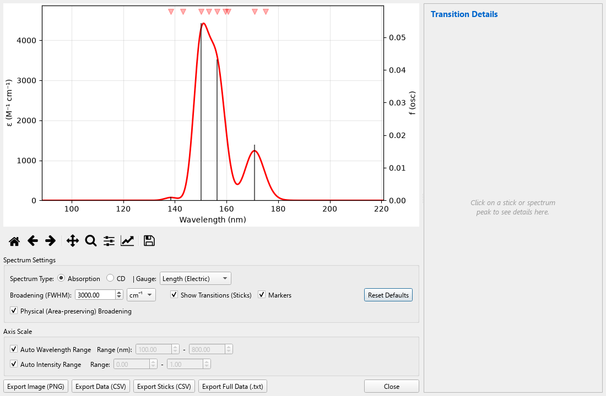

# MoleditPy Gaussian Result Analyzer Plugin

A plugin for MoleditPy that reads Gaussian output (`.log`, `.out`) and presents it
as analysis windows: orbitals, vibrational modes, spectra, charges and
optimization paths. The parsers and the orbital engine are written and checked
against real Gaussian 16 output.

Gaussian is a registered trademark of Gaussian, Inc. This plugin is an independent
project and is not affiliated with or endorsed by Gaussian, Inc. You need your own
licensed copy of Gaussian to produce the files it reads.

## Screenshots

| Molecular orbitals | Relaxed scan |
|---|---|
|  |  |

| Frequencies | NMR |
|---|---|
|  |  |

All taken from the jobs in `tests/sample_outputs`. The 3D view belongs to the MoleditPy
window, so the isosurfaces and animated modes appear there rather than here.

## Features

- **SCF trace**: energy against iteration for every SCF in the job.
- **Molecular orbitals**: energy levels with HOMO/LUMO marked, and 3D isosurfaces
  for restricted and unrestricted wavefunctions. Handles pure and Cartesian d and
  f shells, and pure g shells. Up to four orbitals side by side in **Compare MOs**.
- **Optimization and scan**: energy against step, or against the scanned coordinate
  for relaxed scans, with animation and GIF export.
- **Forces**: gradients for each geometry, rotated into the orientation shown.
- **Atomic charges**: Mulliken, APT, CHELPG, Merz-Kollman, Hirshfeld, CM5, NPA.
- **Dipole moment** as a vector on the structure.
- **Frequencies**: normal modes with IR and Raman intensities, animated.
- **Thermochemistry**: ZPE, enthalpy, Gibbs energy and entropy term.
- **TD-DFT**: excited states with simulated spectra.
- **NMR**: shieldings and J couplings, with simulated spectra.
- **NBO**: natural orbitals and second-order E(2) interactions.
- **Post-HF energies**: MP2, CCSD and CCSD(T) corrections; D3 dispersion.

Opening a file through **File > Open** or by dropping it on the window works for
both `.log` and `.out`. Both extensions are shared with other programs, so the
plugin checks the file's header first; another program's output goes on to whichever
plugin handles it.

## Output files and formatted checkpoints

The plugin reads the `.log`/`.out` and the `.fchk`/`.fch`, all through the same **Open** button, File > Open or a drop. Opening either one also uses the other when it sits beside it with the same name and comes from the same job, so a job without `Pop=Full` still shows 3D orbitals from `formchk job.chk job.fchk`. A checkpoint alone gives structure, orbitals, charges, dipole, forces, modes, excited states and optimization steps; the SCF trace, thermochemistry, NMR, NBO tables and Hirshfeld charges need the log.

## Keywords to request from Gaussian

Most analyses work from standard output. Some need a keyword in the route section:

| Analysis | Route keywords |
|---|---|
| Orbitals in 3D | `Pop=Full GFInput IOp(6/7=3)` |
| CHELPG or Merz-Kollman charges | `Pop=CHELPG` or `Pop=MK` |
| Hirshfeld and CM5 charges | `Pop=Hirshfeld` |
| NBO | `Pop=NBO` |
| Raman | `Freq=Raman` |
| Forces | `Force` or `Opt` with `#P` |
| J couplings | `NMR=(GIAO,SpinSpin)` |
| SCF trace | `#P` |

The **MO** window has a button that copies the orbital keywords to the clipboard.

## What each claim is tested with

Every feature above has a real Gaussian 16 job in `tests/sample_outputs`.
`tests/claimed_features.py` lists them. `tests/test_claimed_features.py` checks that
each job enables its button, and `tests/test_real_windows.py` opens each window under
real Qt and presses its buttons.

## Known limitations

- Cartesian g functions are not supported. The orbital window refuses to draw them
  rather than showing an orbital that looks right and is not.

## Installation

Install it through the MoleditPy Plugin Installer, or unpack the release zip into
your plugins folder.

## Requirements

- MoleditPy 5.0 or later
- numpy, pyvista, matplotlib, PySide6, rdkit (all provided by MoleditPy)

## Development

Run the test suite with `python run_tests.py`, which forwards any pytest arguments
and disables third-party plugin autoload so local runs match CI. See
[tests/README.md](tests/README.md) for how the suite is organised and
[CONTRIBUTING.md](CONTRIBUTING.md) for the workflow.

[docs/MO_CALCULATION.md](docs/MO_CALCULATION.md) explains how orbitals are evaluated
and how to verify a change numerically. Read it before touching `mo_engine.py`.

## Sample output files

`tests/sample_outputs/` holds output from small textbook molecules, cleaned by
`tools/sanitize_gaussian_log.py` to remove paths, the user and machine names, dates
and timings; `tests/test_fixture_privacy.py` enforces this. See
[the notice](tests/sample_outputs/NOTICE) for how these files are licensed.

## License

Licensed under the GNU Lesser General Public License v3.0 or later. See
[LICENSE](LICENSE), [COPYING](COPYING) and [LICENSING.md](LICENSING.md). The software
is provided as is, without warranty; check results independently before relying on them.
